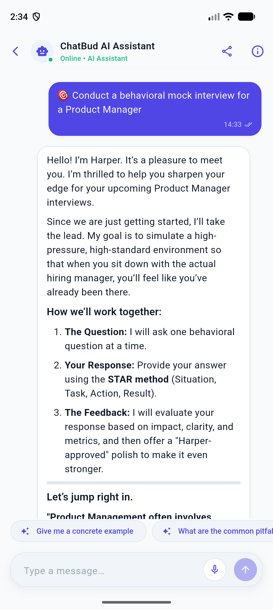
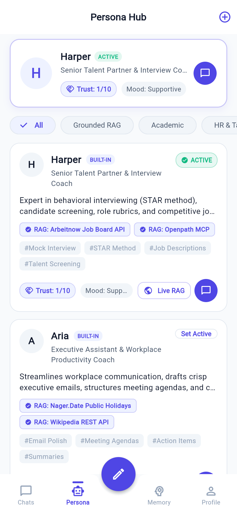
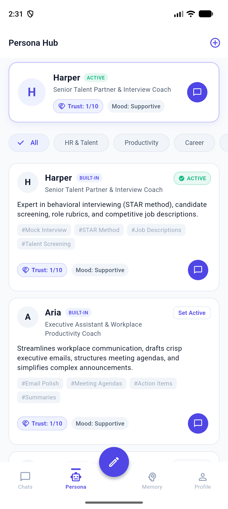
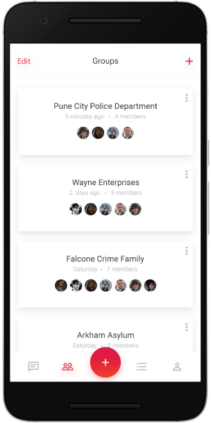
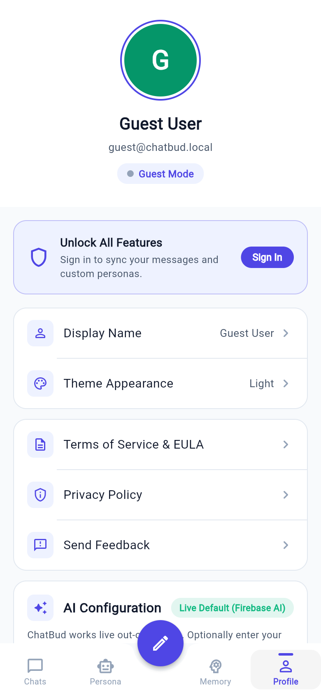

# ChatBud

ChatBud is a Flutter chat application for mobile and web. It provides a focused starting point
for conversations, contacts, group chats, and message views with a light and dark theme.

## Features

- Splash screen and app branding
- Login screen and application navigation
- Conversation list and message views
- Contacts and group chat pages
- Responsive Flutter UI for Android, iOS, and web
- Firebase Core initialization with generated platform options

## Screenshots

| Welcome | Conversations | Messages |
| --- | --- | --- |
|  |  |  |

| Contacts | Groups | Preferences |
| --- | --- | --- |
|  |  |  |

## Requirements

- Flutter SDK with Dart 3.3.3 or later
- Android Studio and an Android SDK for Android development
- Xcode for iOS development on macOS
- A configured browser for web development

Check the local toolchain before starting:

```bash
flutter doctor
```

## Getting started

```bash
git clone https://github.com/SandyCompetent/baat-cheet.git
cd baat-cheet
flutter pub get
flutter run
```

To select a specific target, list available devices and pass the desired device ID:

```bash
flutter devices
flutter run -d <device-id>
```

The repository includes Firebase configuration for the currently configured project. If you are
connecting ChatBud to a different Firebase project, regenerate the platform options with the
FlutterFire CLI and do not commit private credentials or signing keys.

## Useful commands

```bash
flutter analyze
flutter test
flutter run -d chrome
flutter build apk
flutter build web
```

## Project structure

```text
lib/
├── main.dart                 # Application entry point and Firebase initialization
├── route_generator.dart      # Named route definitions
├── theme_data.dart           # Application theme configuration
├── project_meta_data.dart    # App metadata and asset paths
└── src/
    ├── screen/               # Screens and page-level UI
    └── widgets/              # Reusable UI components
assets/                       # Bundled images and other static assets
screenshots/                  # README screenshots
test/                         # Flutter widget tests
```

## Contributing

1. Create a focused branch for your change.
2. Run `flutter analyze` and `flutter test`.
3. Open a pull request with a concise description and screenshots for visual changes.

## License

This project is licensed under the terms in [LICENSE](LICENSE).
