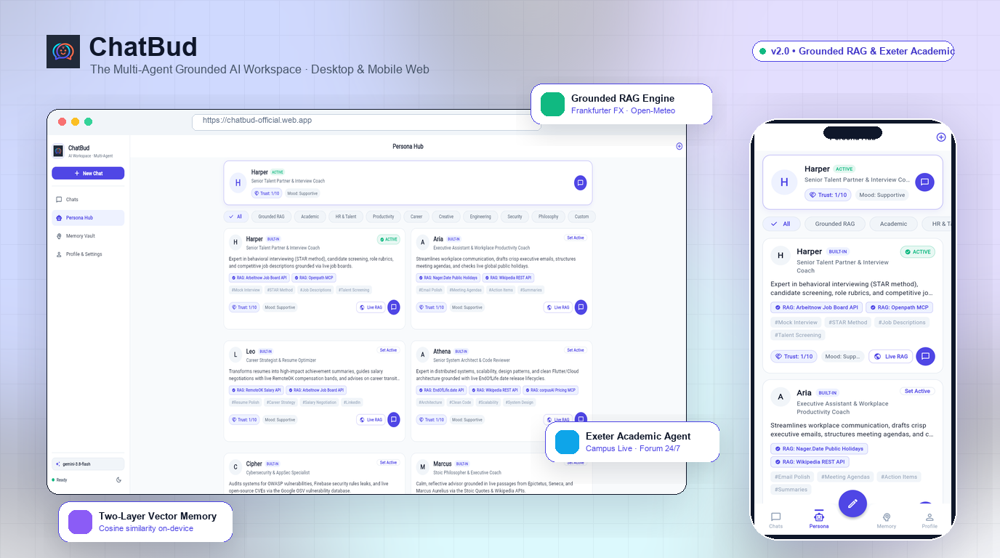
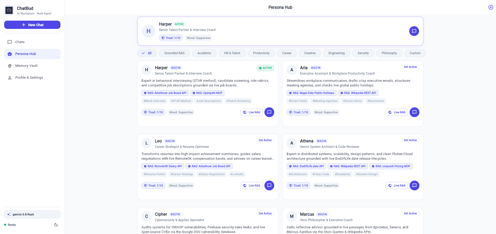
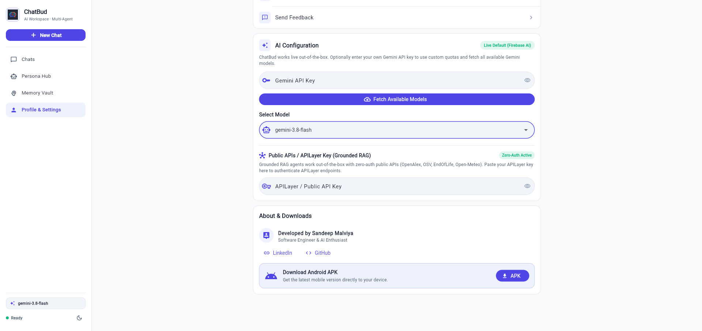
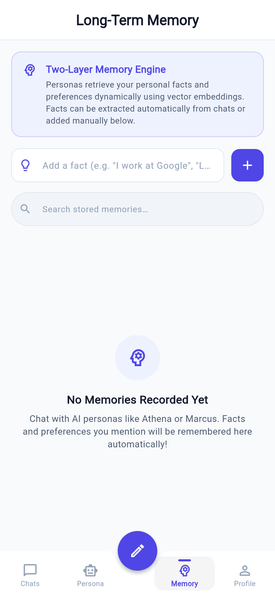

# ChatBud — Stateful Multi-Agent Workspace & Grounded RAG Platform

[](https://github.com/SandyCompetent/chatbud)
[](#-portfolio--non-commercial-disclaimer)
[](https://flutter.dev)
[](https://firebase.google.com/docs)
[](#grounded-rag-engine)
[](#testing)
[](LICENSE)

> [!IMPORTANT]
> ### 📌 Portfolio & Architectural Demonstration Notice
> **ChatBud is an open-source technical showcase and developer portfolio project** created by Sandeep Malviya to demonstrate modern multi-agent systems, Grounded RAG with live APIs, on-device vector memory, and responsive Flutter engineering.
>
> ⚠️ **Not a Commercial Product**: This application is **strictly for demonstration, educational exploration, and portfolio evaluation purposes**. It is **NOT** intended, licensed, or supported for commercial, production, or live business use.

**ChatBud** is a stateful multi-agent messaging showcase application built with **Flutter**, **Firebase AI (`firebase_ai`)**, and a **100% free serverless architecture** to demonstrate real-world AI agent orchestration patterns.

Going beyond standard single-turn LLM wrappers, ChatBud features an **on-device Grounded RAG Engine** powered by live public APIs with verified inline citations, an **Open-Source Persona Hub (16 curated agents)**, **Exeter Academic Agent with Campus Live Hub**, **Bring Your Own Key (BYOK) Gemini Model Selection**, **Two-Layer Vector Memory**, and **Desktop & Mobile Web responsive layouts**.



---

## 🌐 Instant Live Demos & Downloads

1. **🌐 Web Application**: Open **[https://chatbud-official.web.app](https://chatbud-official.web.app)** in any desktop or mobile browser.
2. **📱 Android APK**: Download the latest release from [GitHub Releases](https://github.com/SandyCompetent/chatbud/releases).
3. **💻 Portfolio Showcase**: View the interactive showcase website in `portfolio/index.html` (light mode) and `portfolio/index.dark.html` (dark mode).
4. **🚀 Zero-Login Guest Mode**: Start chatting immediately with zero registration or credentials required.

---

## 📸 Desktop & Mobile Experience

| Desktop Navigation Rail & Grounded Chat | Mobile Grounded Chat & Citations |
| :---: | :---: |
|  |  |

| Responsive Persona Hub Grid | Local Vector Memory Vault |
| :---: | :---: |
|  |  |

---

## Architecture Overview

```
                      ┌──────────────────────────────────────┐
                      │          ChatBud Flutter App         │
                      │   (Desktop Rail & Mobile App Bar)    │
                      └──────────────────┬───────────────────┘
                                         │
             ┌───────────────────────────┼───────────────────────────┐
             ▼                           ▼                           ▼
  ┌─────────────────────┐     ┌─────────────────────┐     ┌─────────────────────┐
  │   PersonaService    │     │ PublicApiRagService │     │    MemoryService    │
  │ • 16 Curated Agents │     │ • Frankfurter FX    │     │ • Working Context   │
  │ • Exeter Academic   │     │ • Open-Meteo Weather│     │ • Pure Dart Cosine  │
  │ • 1-Tap Presets     │     │ • APILayer Keys     │     │ • Episodic Vault    │
  └──────────┬──────────┘     └──────────┬──────────┘     └──────────┬──────────┘
             │                           │                           │
             └───────────────────────────┼───────────────────────────┘
                                         ▼
                      ┌──────────────────────────────────────┐
                      │             ChatService              │
                      │ • Live RAG Prompt Grounding          │
                      │ • Dynamic Citation Source Badges     │
                      │ • BYOK Gemini 2.5 / 2.0 / 1.5 Switch │
                      │ • Group @Persona Mentions            │
                      │ • Firestore + Local Offline Cache    │
                      └──────────────────────────────────────┘
```

---

## Standout Features

### 1. Grounded RAG Engine with Live Public APIs & Citations
- **Zero-Hallucination External Grounding**: Connects directly to verified public APIs before response synthesis.
- **Supported Live Data Sources**:
  - **Foreign Exchange & Currency**: Real-time European Central Bank rates via Frankfurter and high-volume APILayer conversion.
  - **Global Weather**: Live temperatures, humidity, wind conditions, and forecasts via Open-Meteo.
  - **Reference & Knowledge**: Verified word origins and definitions, nutritional facts via Open Food Facts, and web search summaries.
- **Visual Citation Badges**: Messages grounded with external API data display clear source badges with timestamp verification directly in the message bubble.

### 2. Exeter Academic Agent & Campus Live Sheet
- **University of Exeter Study Companion**: Designed specifically for Exeter students and academic staff.
- **Interactive Campus Live Sheet**: Access real-time Streatham & St Luke's campus navigation, Forum Library 24/7 hours and book catalogue, Guild society directories, and exam study schedules.

### 3. Open-Source Persona Hub (16 Curated Agents)
- **Comprehensive Persona Roster**:
  - **Grounded RAG Expert**: Live external data lookups with citations.
  - **Exeter Academic**: Campus live sheet, research papers, and study schedules.
  - **Harper**: HR & Talent Coach for behavioral mock interviews and job specs.
  - **Aria**: Workplace Executive Assistant for email drafting and agenda synthesis.
  - **Leo**: Career & Resume Coach for high-impact metric rewrites.
  - **Athena**: Senior System Architect for clean software architectures.
  - **Cipher**: Application Security & threat modeling specialist.
  - **Marcus**: Stoic Philosopher for leadership resilience.
  - **Nova**: Creative Brand Strategist & Storyteller.
  - Plus 7 additional tailored agents across Finance, Translation, Nutrition, Health, and Coding.
- **1-Tap Preset Persona Authoring**: Tap any role template to instantly create custom agents without prompt engineering.
- **Dynamic Starter Prompts**: Suggested quick-prompts displayed initially, automatically hidden once chat begins.
- **Safe Message Generation**: Send button disables with a loading spinner while AI tokens stream to prevent race conditions.

### 4. Desktop & Mobile Responsive Workspace
- **Desktop (Viewport >= 840px)**:
  - Persistent left **Navigation Rail** featuring Brand Logo, "New Chat" primary action, section items, active Gemini model pill, theme toggle, and connection status.
  - **Centered distraction-free canvas** with `maxWidth` constraints (680px bubbles, 960px feed, 1140px Persona Grid).
  - **Physical keyboard shortcuts**: <kbd>Enter</kbd> sends messages instantly, <kbd>Shift+Enter</kbd> creates a newline.
  - **Multi-column GridView** for Persona cards on large screens.
- **Mobile (Viewport < 840px)**:
  - Touch-optimized bottom app bar with docked FAB, bottom sheets, and single-column feed.

### 5. Two-Layer Memory Engine (100% Free Tier)
- **Layer 1 (Working Context)**: Sliding multi-turn conversation history cached in memory and `StorageService` (`SharedPreferences`).
- **Layer 2 (Episodic Long-Term Memory)**:
  - **Pure-Dart Vector Search**: Lexical term embedder with L2-normalized cosine similarity (<1ms latency, $0.00 cloud cost, no API keys, fully offline).
  - **Fact Extraction & Hygiene**: User preferences, projects, and goals are captured automatically and stored with confidence scores.
  - **Memory Vault UI**: Full user control to view, add, or delete recalled memories transparently.

### 6. Hybrid AI Engine: Firebase AI + Bring Your Own Key (BYOK)
- **Live Out-of-the-Box**: Powered by Google's Gemini 2.5 / 2.0 developer stack with a 100% free serverless tier.
- **Bring Your Own Gemini Key**: Configure your own Google AI Studio API key in **Profile → AI Configuration** to route with custom quotas.
- **Model Selector**: Switch dynamically between `gemini-2.5-flash`, `gemini-2.0-flash`, `gemini-1.5-pro`, or `gemini-1.5-flash`.
- **APILayer Key Integration**: Input your APILayer key in settings to unlock high-volume currency conversion and financial tools.

---

## Project Structure

```text
lib/
├── main.dart                      # App entry point, desktop navigation rail, and tabs
├── route_generator.dart           # Declarative named routes
├── theme_data.dart                # Soft Minimalist Slate design system
├── project_meta_data.dart         # App metadata and branding constants
└── src/
    ├── models/
    │   ├── chat_message.dart      # Chat messages with status and RAG citations
    │   ├── conversation.dart      # Conversation metadata with personaId support
    │   ├── persona.dart           # Persona schema with 16 curated presets
    │   ├── relationship_state.dart# Trust levels, mood, and interaction counters
    │   └── user_memory.dart       # Episodic facts with vector embeddings
    ├── services/
    │   ├── chat_service.dart      # Real-time message streaming & RAG grounding router
    │   ├── public_api_rag_service.dart # Real-time public API integrations & APILayer
    │   ├── gemini_service.dart    # Firebase AI & BYOK Gemini generative engine
    │   ├── memory_service.dart    # On-device cosine similarity & memory retrieval
    │   └── persona_service.dart   # Persona hub repository & active agent state
    ├── core/
    │   ├── app_state.dart         # Global auth and theme state
    │   └── storage_service.dart   # Offline persistence with SharedPreferences
    └── screen/
        ├── message_page.dart      # Primary chat feed with search and filter chips
        ├── persona_hub_screen.dart# Persona catalog, responsive GridView, creation modal
        ├── conversation_screen.dart# Real-time token streaming chat interface
        ├── memory_page.dart       # Local Vector Memory Vault
        └── contact_page.dart      # Profile, BYOK Gemini settings, APILayer key, theme
test/                              # 159 automated unit and widget tests
portfolio/                         # Responsive portfolio website (light & dark)
```

---

## Testing

ChatBud includes a comprehensive test suite with **159 automated tests**:

```bash
# Run all unit and widget tests
flutter test

# Run code static analysis
flutter analyze
```

---

## Getting Started

1. **Clone the repository**:
   ```bash
   git clone https://github.com/SandyCompetent/chatbud.git
   cd chatbud
   ```

2. **Install dependencies**:
   ```bash
   flutter pub get
   ```

3. **Run on your device or browser**:
   ```bash
   # Run on Chrome Web
   flutter run -d chrome

   # Run on Android or iOS
   flutter run
   ```

4. **Build for Web Release**:
   ```bash
   flutter build web --release
   ```

---

## ⚠️ Portfolio & Non-Commercial Disclaimer

This repository, along with any live hosted web demonstrations (`web.app`) or downloadable APK artifacts, is published exclusively as a personal **developer portfolio and architectural proof of concept**:

1. **Portfolio Showcase & Technical Review**: ChatBud serves to exhibit real-world software engineering capabilities — specifically cross-platform Flutter/Dart engineering, stateful multi-agent systems, on-device vector retrieval (cosine similarity), live API prompt grounding, and responsive UI across desktop and mobile.
2. **Not a Live Commercial Service**: ChatBud is **not** a commercial product, SaaS offering, or subscription business. There are no commercial warranties, service-level agreements (SLAs), or paid customer obligations.
3. **Quotas & Resource Fair Use**: Deployed web and API endpoints operate on free developer quotas (Firebase Spark plan, Google AI Studio free tier, Open-Meteo, Frankfurter). It is not architected or intended for high-traffic or mission-critical commercial deployments.
4. **Third-Party Keys**: The BYOK (Bring Your Own Key) feature is provided solely for developers and recruiters evaluating custom model routing with their own private developer keys.

---

## License & Terms of Use

This project is licensed under the [MIT License](LICENSE).

> **Disclaimer**: This software is provided as a portfolio demonstration on an "as is" and "as available" basis, without warranties or conditions of any kind, either express or implied. Under no circumstances should this codebase be deployed as a commercial live service without independent compliance, commercial hosting infrastructure, and security validation.
